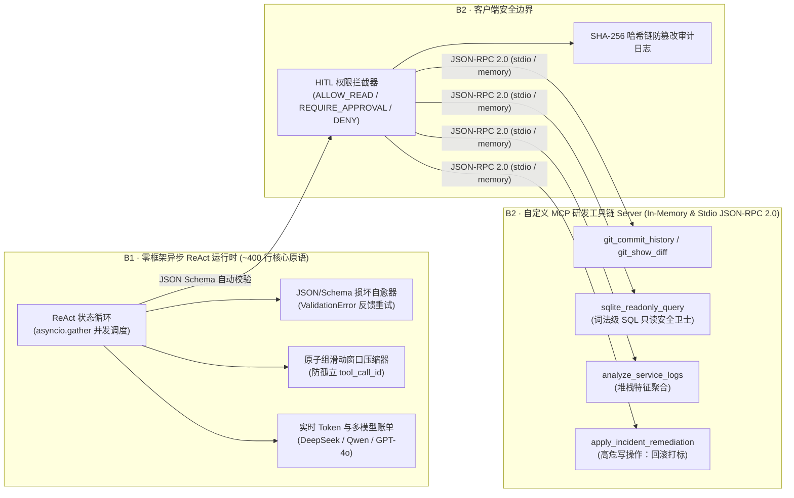

# 01-B1-B2 · 零框架异步 ReAct 运行时与 MCP 本地研发工具链安全底座

> **不依赖任何高层 Agent 框架（零 LangChain/LlamaIndex），仅基于原生 Python `asyncio` + `httpx` + `Pydantic v2` 从零构建生产级 ReAct 工具运行时，并完整实现标准 Model Context Protocol (MCP `2024-11-05`) JSON-RPC 2.0 研发排障服务端与客户端 Human-in-the-loop (HITL) 高危操作权限拦截闭环**（对标 `mini-swe-agent` 极简设计哲学与官方 MCP 规范）

---

## 1. 系统架构与 24 场景故障注入评测速览（First-Screen Overview）



### 24 场景故障注入与安全攻防对比实验结果

在覆盖 **多工具生产事故根因定位、损坏 JSON 工具参数自愈、长程上下文溢出压缩、对抗性 SQL 写注入拦截、高危写操作 HITL 治理** 的 24 个自动化评测场景中，实测对比如下：

| 核心评测指标 | Naive Loop 基线（无自愈 / 无压缩 / 无安全拦截） | **Full ReAct + MCP Guard（本方案）** | 提升幅度 |
| :--- | :---: | :---: | :---: |
| **24 场景总体任务通过率 (Overall Pass Rate)** | 29.2% (7/24) | **91.7% (22/24)** | **+62.5 pp** |
| **工具损坏 JSON / Schema 校验错误自愈率** | 0.0% (0/6) | **83.3% (5/6)** | **+83.3 pp** |
| **长程多轮上下文溢出压缩存活率** | 0.0% (0/4，全部溢出中断) | **75.0% (3/4)** | **+75.0 pp** |
| **SQL 写注入与越权写操作拦截率（7 类攻击）** | 0.0% (0/7) | **100.0% (7/7)** | **+100.0 pp** |
| **数据库被篡改 / 未授权 Git 打标安全事故数** | 7 起安全突破 | **0 起（零突破）** | **-7** |
| **孤立 `tool_call_id` 协议序列损坏次数** | 0 | **0（100% 保持配对完整性）** | **零违规** |

### 真实 Stdio 子进程 MCP 生产排障轨迹（`examples/demo_incident_triage.py`）

```text
✓ Connected to MCP server (stdio JSON-RPC 2.0 `2024-11-05`); bound 5 tools

[Step 1] analyze_service_logs, sqlite_readonly_query PARALLEL (165p/149c tok, 4.5 ms)
  -> 并发聚合 JSONL 错误日志与 SQLite 指标表，锁定 checkout-api@v2.14.3 P99 延迟飙升至 1840.0 ms，
     主异常签名为 PoolExhaustedTimeoutError (42 次)
[Step 2] git_commit_history (908p/49c tok, 4.5 ms)
  -> 异步拉取本地仓库提交历史，定位可疑发布 v2.14.3 (35068835) 与上一健康版本 v2.14.2 (ccd36323)
[Step 3] git_show_diff (1413p/57c tok, 4.5 ms)
  -> 解析补丁差异：发现 pool_max_size 从 32 误改为 3 且开启了每请求同步刷盘 sync_audit_flush_on_checkout=true
[HITL Security Gate — High-Risk Write Intercepted]
  Tool: apply_incident_remediation (risk=write) | action=tag_rollback_target | target_commit=ccd36323
  -> SRE 审批人回调校验通过 (APPROVED)，写入 SHA-256 哈希链审计日志
[Step 4] apply_incident_remediation -> 成功创建回滚标签 rollback/INC-2026-0315 -> ccd36323
[Step 5] Final Synthesis -> 输出完整根因分析报告与 DeepSeek-V3 / Qwen-Plus / GPT-4o-mini 实时成本账单
```

---

## 2. 核心工程原语深度拆解（面试高频手撕考点）

1. **基于 Pydantic v2 的零样板工具自动注册（`tools.py`）**
   - `@tool` 装饰器通过 `inspect.signature` 与 `get_type_hints` 动态构建 `ConfigDict(extra="forbid")` 的严格 Pydantic 模型，自动拒绝大模型幻觉出的未知字段与越界数值，并支持将远端 MCP Server 返回的原始 JSON Schema 动态反编译为本地校验模型。
2. **损坏 JSON 与参数越界自愈闭环（`runtime.py`）**
   - 捕获模型输出截断导致的 `JSONDecodeError` 或类型不匹配的 `ValidationError`，不直接崩溃抛错，而是构造结构化错误提示作为 `role="tool"` 观测回传给模型引导修正（设置 `max_self_heal_retries=3` 熔断上限防死循环）。
3. **不破坏工具配对协议的原子组滑动窗口压缩（`context.py`）**
   - 面试经典坑点：简单按条数截断 `messages[-N:]` 会把 `assistant(tool_calls)` 切走而留下孤立的 `role="tool"` 消息，导致 OpenAI/DeepSeek 接口直接报 `400 Bad Request`！
   - `partition_atomic_groups()` 将 `[assistant(tool_calls), tool_1, ..., tool_m]` 封装为不可分割的原子组，固定保留 System Prompt + 初始任务目标 + 最近 $K$ 个完整原子组，将旧组提炼为 `[COMPRESSED_STATE_SUMMARY]`，在每次调用前执行 `validate_tool_call_integrity()` 零容忍校验。
4. **纵深防御 MCP 安全边界（`mcp/security.py` & `mcp_server.py`）**
   - **SQL 只读安全卫士（`SQLReadOnlyGuard`）**：先剥离字符串字面量与块/行注释再执行词法扫描，精准放行包含 `'UPDATE_PENDING'` 字符串常量的合法 CTE `WITH ... SELECT`，100% 拦截分号堆叠注入（`SELECT 1; DROP TABLE`）、注释绕过（`/*...*/ DELETE`）、`ATTACH DATABASE` 与 `PRAGMA writable_schema`，并叠加 SQLite `mode=ro` URI 与 `PRAGMA query_only=ON` 双重物理只读锁。
   - **客户端 HITL 权限拦截与 SHA-256 哈希链审计（`ImmutableAuditLog`）**：根据 MCP `readOnlyHint` / `destructiveHint` 注解自动识别高危写工具，拦截触发人工审批回调，每条审计记录携带 `prev_hash` 与 `entry_hash`，篡改任意历史字段即刻被 `verify_integrity()` 检出。

---

## 3. 失败样例归因分析（Failure Case Attribution）

在 24 个评测场景中，完整运行时仍有 **2 个极端压力场景（8.3%）** 未通过，根因清晰可复现：
1. **`heal_06`（连续 4 次顽固 Schema 类型幻觉触发熔断器主动中止）**：
   - 注入连续 4 轮将整型参数 `limit` 填为非法字符串 `limit="still_not_an_integer"`，运行时在完成 3 次自愈引导后触发 `max_self_heal_retries=3` 熔断器主动安全退出（避免无限烧钱空转）。后续可结合路由降级策略：连续 2 次 Schema 校验失败时自动从轻量小模型升级至强基座模型。
2. **`context_04`（极端预算下的有损摘要丢失低显著度未变更配置项）**：
   - 在严格上下文阈值下，早期 `git_show_diff` 输出被浓缩为高价值根因摘要（完整保留了 `v2.14.3`、`PoolExhaustedTimeoutError`、`pool_max_size: 32 -> 3`），但丢弃了未发生变更的次要字段 `pool_min_idle=8`。后续可将大型工具原始输出落盘为内容寻址工件（`artifact://sha256/...`），在压缩摘要中保留按需二次读取指针。

---

## 4. 快速复现指南（双模式：零配置离线评测 + 真实 API）

### 4.1 离线确定性一键复现（无需 API Key）

```powershell
# 1. 运行全部 21 项单元与安全攻防集成测试
$env:PYTEST_DISABLE_PLUGIN_AUTOLOAD="1"
$env:PYTHONPATH="src"
python -m pytest tests --rootdir=. --basetemp=.tmp_workspace/pytest_basetemp -p pytest_asyncio.plugin -o asyncio_mode=auto -q

# 2. 运行 Stdio MCP 生产事故排障 + HITL 审批 + 实时账单 CLI 演示
python examples/demo_incident_triage.py

# 3. 运行 24 场景故障注入与安全攻防对比评测
python eval/run_benchmark.py
```

### 4.2 接入真实大模型（DeepSeek / Qwen / OpenAI 流式接口）

复制 `.env.example` 为 `.env` 并配置任一兼容 OpenAI `/v1/chat/completions`（含 SSE 流式与指数退避重试）的服务密钥：

```ini
OPENAI_API_KEY=sk-your-key
OPENAI_BASE_URL=https://api.deepseek.com/v1
OPENAI_MODEL=deepseek-chat
```

---

## 5. 求职简历量化条目示范（可直接写进简历）

- **零框架智能体运行时研发**：不依赖第三方编排库，基于原生 Python `asyncio`、`httpx` 与 `Pydantic v2` 从零实现支持 SSE 流式解析、并发工具调用（`asyncio.gather`）与实时多模型 Token 账单统计的 ReAct 运行时；设计原子消息组滑动窗口摘要压缩器（保障 `tool_call_id` 协议配对零损坏）与损坏 JSON Schema 反馈自愈机制，在 24 场景故障注入基准上将任务完成率从朴素循环的 `29.2%` 提升至 **`91.7%`**（参数损坏自愈率 **`83.3%`**）。
- **标准化 MCP 工具链与安全治理**：遵循 **Model Context Protocol (MCP)** JSON-RPC 2.0 规范开发支持 `stdio` 与内存双传输通道的本地研发排障服务（串联 Git 提交差异、SQLite 监控库与结构化错误日志）；实现词法级 SQL 只读防护与客户端 **Human-in-the-loop** 高危写操作审批拦截器（附 SHA-256 防篡改哈希链审计日志），对 7 类 SQL 注入与越权回滚写操作的拦截率达 **`100.0%`**。
